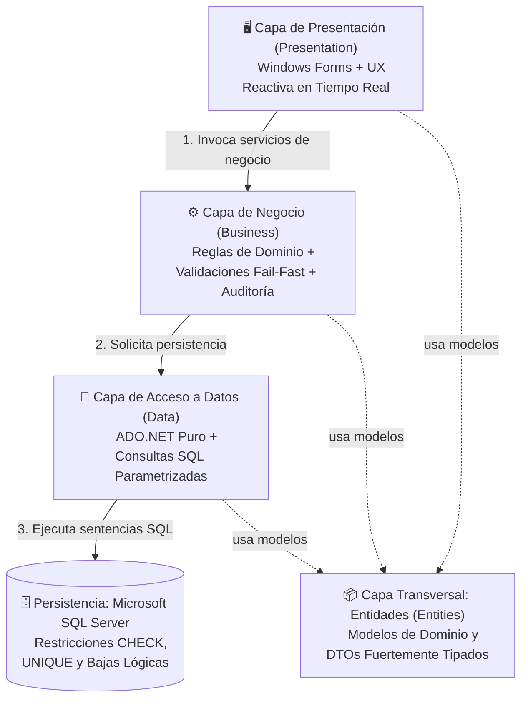

<div align="center">

# 🧉 Matiensos — Sistema de Gestión de Ventas

**Solución integral de escritorio orientada a la gestión operativa, control de inventario en tiempo real y facturación para locales comerciales.**

[](https://dotnet.microsoft.com/)
[](https://docs.microsoft.com/dotnet/csharp/)
[](https://learn.microsoft.com/dotnet/desktop/winforms/)
[](https://www.microsoft.com/sql-server/)
[](#-arquitectura-de-software)
[](https://www.exa.unne.edu.ar/)

</div>

---

## 📌 Información Institucional

- **Universidad:** Universidad Nacional del Nordeste (UNNE)
- **Facultad:** Facultad de Ciencias Exactas y Naturales y Agrimensura (FaCENA)
- **Carrera:** Licenciatura en Sistemas de Información
- **Cátedra:** Taller de Programación II (2026)
- **Equipo de Desarrollo:**
  - Romero, Ingrid Luana
  - Torres, Jemina Cesia

---

## 📖 Descripción del Proyecto

**Matiensos** es una aplicación de escritorio diseñada bajo estándares de ingeniería de software para resolver de manera centralizada la operatoria comercial de un local físico especializado en la venta de artículos materos (termos, mates, bombillas, yerberas y accesorios).

El sistema erradica discrepancias de inventario mediante **control transaccional de stock en tiempo real**, agiliza los tiempos de atención en mostrador a través de un **Punto de Venta (POS) intuitivo**, salvaguarda la consistencia económica mediante el **congelamiento de precios históricos** y garantiza la transparencia operativa a través de un **doble nivel de auditoría inalterable**.

---

## 🚀 Guía de Despliegue Rápido

Esta sección permite poner en marcha el sistema en un entorno local en menos de **2 minutos**.

### 1. Requisitos Previos
- Visual Studio 2022 (o superior) con la carga de trabajo *Desarrollo de escritorio de .NET*.
- Microsoft SQL Server 2019 / 2022 o SQL Server Express Edition (instancia local estándar `.` o `.\SQLEXPRESS`).

---

### 2. Puesta en Marcha de la Base de Datos

1. Abrir **SQL Server Management Studio (SSMS)** o el explorador de servidores de Visual Studio.
2. Abrir y ejecutar el script integral ubicado en:
   ```text
   Data/Database/Matiensos_db_script.sql
   ```
   *(Alternativamente, pueden ejecutarse en orden: `01_DDL_Tablas.sql` y `02_DML_Datos.sql`).*
3. El script crea la base de datos `Matiensos_db`, su esquema relacional normalizado en 3FN y carga automáticamente los **datos semilla de prueba** (roles, usuarios, clientes, categorías, métodos de pago y productos con stock).

---

### 3. Configuración de Cadena de Conexión

La conexión centralizada se encuentra en [`Presentation/App.config`](Presentation/App.config). Por defecto está configurada para instancias locales estándar:

```xml
<connectionStrings>
  <add name="MatiensosConnection" 
       connectionString="Data Source=.;Initial Catalog=Matiensos_db;Integrated Security=True;" 
       providerName="System.Data.SqlClient" />
</connectionStrings>
```

> **Nota:** Si utiliza una instancia con nombre como `.\SQLEXPRESS`, modifique el parámetro `Data Source=.\SQLEXPRESS;` en dicho archivo.

---

### 4. Compilación y Ejecución

1. Abrir la solución [`Matiensos_db.slnx`](Matiensos_db.slnx) en Visual Studio.
2. Establecer el proyecto **`Presentation`** como proyecto de inicio (*Set as Startup Project*).
3. Presionar **F5** o hacer clic en **Iniciar** (*Debug/Release*).

---

### 5. Matriz de Credenciales de Prueba

El sistema cuenta con cuentas semilla listas para evaluar cada rol jerárquico:

| Rol | Correo Electrónico | Contraseña | Alcance Operativo |
| :--- | :--- | :--- | :--- |
| **Super Administrador** | `admin@matiensos.com` | `Admin123!` | Control total: ABM de usuarios, roles, auditoría global y backup. |
| **Administrador** | `super@matiensos.com` | `Super123!` | Gestión de catálogo (productos, categorías, métodos de pago) y auditoría. |
| **Vendedor** | `vendedor@matiensos.com` | `Ventas123!` | Punto de venta, cobro, emisión de tickets e historial propio de ventas. |

> **Cliente Consumidor Final:** Para ventas rápidas de mostrador donde el cliente no desea registrar sus datos, se reserva automáticamente el cliente **"Consumidor Final"** (DNI `99999999`), exclusivo para facturación sin acceso al sistema.

---

## 🏛️ Arquitectura de Software

El sistema implementa una **Arquitectura en 4 Capas Físicas y Lógicas Desacopladas**, garantizando una estricta separación de responsabilidades (*Separation of Concerns - SoC*) y un flujo de dependencias unidireccional y limpio:



### 🔗 Matriz de Dependencias:

| Capa | Conoce a | NO Conoce a | Responsabilidad Principal |
| :--- | :--- | :--- | :--- |
| **`Presentation`** | `Business`, `Entities` | `Data`, Base de Datos | Captura eventos de usuario, valida entradas reactivamente y muestra datos. Prohibido ejecutar SQL. |
| **`Business`** | `Data`, `Entities` | `Presentation`, Controles UI | Aplica reglas de negocio, valida precondiciones (*Fail-Fast*) y orquesta transacciones. |
| **`Data`** | `Entities`, SQL Server | `Business`, `Presentation` | Ejecuta comandos ADO.NET (`SqlCommand`, `SqlDataReader`) parametrizados de forma segura. |
| **`Entities`** | *(Ninguna capa)* | `Data`, `Business`, `Presentation` | **Capa transversal independiente**. Define las clases y DTOs del dominio compartidos por todos. |

---

### Descripción Detallada de Capas:

1. **`Presentation` (Capa de Presentación):**  
   Interfaz gráfica desarrollada en Windows Forms. Incorpora validación sintáctica reactiva en tiempo real (eventos `KeyPress`, `TextChanged` y `Leave`), resaltado visual de errores (`MistyRose`) para evitar falsos positivos y una biblioteca centralizada de estilos visuales ([`Diseño.cs`](Presentation/Diseño.cs)).
2. **`Business` (Capa de Reglas de Negocio):**  
   Orquesta la lógica del local comercial. Aplica el principio *Fail-Fast*, validando precondiciones antes de delegar persistencia, gestiona la sesión activa y registra eventos en la bitácora mensual de auditoría.
3. **`Data` (Capa de Acceso a Datos):**  
   Implementa persistencia directa mediante **ADO.NET puro** (`SqlCommand`, `SqlDataReader`, `SqlTransaction`), empleando tipado estricto de parámetros SQL para garantizar inmunidad total contra inyecciones SQL (*SQL Injection*).
4. **`Entities` (Capa de Entidades del Dominio):**  
   Clases fuertemente tipadas que representan las estructuras del negocio (`Producto`, `Categoria`, `MetodoPago`, `Venta`, `DetalleVenta`, `Cliente`, `Usuario`, etc.), utilizadas de manera transversal.

---

## 🧩 Principios de Diseño y Buenas Prácticas (Clean Code & SOLID)

- **Single Responsibility Principle (SRP):** Cada clase posee una única razón de cambio. Las clases de datos solo gestionan SQL; las de negocio aplican reglas comerciales; los formularios solo controlan interacción de usuario.
- **Fail-Fast (Falla Rápida):** Cualquier anomalía (stock insuficiente, campos obligatorios vacíos, caracteres no permitidos o nombres duplicados) se detecta y rechaza inmediatamente en las capas superiores antes de consumir recursos de base de datos.
- **Inmutabilidad Contable:** El precio unitario de venta se congela en la tabla `sale_detail` al momento exacto de la transacción. Futuras modificaciones en la lista de precios no alteran los balances históricos.
- **Bajas Lógicas (Soft Delete):** Ningún registro con historial transaccional se elimina físicamente de la base de datos. Se actualiza `is_active = 0` y se registra la fecha en `deleted_at`, preservando la integridad referencial.
- **Auditoría de Doble Nivel:**
  1. *Nivel Relacional:* Columnas de autoría y fecha (`created_at`, `created_by`, `updated_at`, etc.) en cada tabla de SQL Server.
  2. *Nivel Aplicación:* Bitácora mensual inalterable en archivos de texto plano (`.log`) gestionada por [`AuditoriaBusiness`](Business/AuditoriaBusiness.cs).

---

## 🎯 Módulos Funcionales

1. **Seguridad y Control de Acceso (RBAC):**  
   Autenticación segura con hashing de contraseñas, control dinámico de visibilidad según rol activo y protección contra baja del último SuperAdmin.
2. **Gestión de Personal y Cuentas:**  
   ABM de usuarios vinculado a persona física, asignación de roles y control estricto de duplicidad de DNI y correos.
3. **Catálogo e Inventario:**  
   ABM de Productos y Categorías con códigos alfanuméricos únicos de 4 caracteres, alertas de stock mínimo y reactivación ágil de registros.
4. **Gestión de Métodos de Pago:**  
   Catálogo parametrizado de medios de cobro (nombre único hasta 50 caracteres) con tarjetas KPI operativas de recaudación.
5. **Punto de Venta (POS) y Facturación:**  
   Venta de mostrador ágil, verificación y descuento atómico de stock, asignación de clientes o Consumidor Final y emisión de tickets.
6. **Auditoría y Trazabilidad:**  
   Visor de eventos del sistema con filtros por fecha y acción, exportación de reportes y consulta de ventas para cajeros.
7. **Continuidad Operativa (Respaldo):**  
   Generación de copias de seguridad nativas de SQL Server (`.bak`) y procedimientos de restauración ante contingencias.

---

## 📚 Documentación de Ingeniería de Software

El proyecto cuenta con documentación formal de nivel académico e industrial disponible en el directorio [`/docs`](docs):

- 📋 [**Especificación de Requerimientos de Software (ERS)**](docs/ERS.md)  
  *Alcance modular, 24 Requisitos Funcionales (RF), Requisitos No Funcionales (RNF) y 26 Reglas de Negocio.*
- 🗄️ [**Diagrama Entidad-Relación y Modelo de Datos (DER)**](docs/DER.md)  
  *Esquema formal 3FN, diagrama Mermaid interactivo, cardinalidades y restricciones nativas de integridad.*
- 🎯 [**Modelado Funcional: Casos de Uso**](docs/CASOS_DE_USO.md)  
  *Diagrama general de casos de uso, matriz de trazabilidad y especificaciones narrativas detalladas (CU-01 a CU-13).*
- 📖 [**Diccionario de Datos**](docs/DICCIONARIO_DATOS.md)  
  *Especificación exhaustiva de las 9 tablas, tipos de datos físicos, nulabilidad, claves y checks.*

---

## 📁 Estructura del Repositorio

El proyecto organiza su código fuente respetando estrictamente la separación de responsabilidades en capas y submódulos funcionales:

```text
Matiensos_db/
├── Matiensos_db.slnx                 # Archivo de solución de Visual Studio
├── README.md                         # Portada principal y guía de despliegue
│
├── docs/                             # Documentación formal de Ingeniería de Software
│   ├── ERS.md                        # Requerimientos de Software (IEEE 830) y Reglas de Negocio
│   ├── DER.md                        # Diagrama Entidad-Relación y Modelo Lógico 3FN
│   ├── CASOS_DE_USO.md               # Casos de Uso (CU-01 a CU-13) y Matriz de Trazabilidad
│   ├── DICCIONARIO_DATOS.md          # Diccionario de Datos de las 9 tablas SQL
│   └── img/                          # Diagramas e imágenes del proyecto
│       ├── DER.png                   # Imagen del Diagrama Entidad-Relación
│       └── CASOS_DE_USO.png          # Imagen del Diagrama de Casos de Uso
│
├── Presentation/                     # Capa de Presentación (Windows Forms)
│   ├── App.config                    # Cadenas de conexión y configuración de la app
│   ├── Program.cs                    # Punto de entrada de la aplicación WinForms
│   ├── Diseño.cs                     # Motor centralizado de temas, estilos, colores y fuentes
│   ├── FormLogin.cs                  # Autenticación, validación de credenciales y ruteo por rol
│   ├── FormPanelSuperAdmin.cs        # Panel principal del Super Administrador
│   ├── FormUsuario.cs                # Administración de cuentas de empleados (ABM)
│   ├── FormCliente.cs                # Administración y búsqueda de clientes
│   ├── FormCategorias.cs             # Grilla y gestión de categorías del catálogo
│   ├── FormNuevaCategoria.cs         # Modal de alta de categoría con validación reactiva
│   ├── FormProductos.cs              # Grilla general de productos y control de stock
│   ├── FormMetodosPago.cs            # Grilla y KPI cards de métodos de cobro
│   ├── FormNuevoMetodoPago.cs        # Modal de alta de método de pago con validación en tiempo real
│   ├── FormAuditoria.cs              # Visor de bitácora mensual de auditoría y filtros
│   ├── FormDetalleAuditoria.cs       # Modal de detalle extendido de evento de auditoría
│   ├── GeneradorReporteAuditoria.cs  # Exportación y generación de reportes de auditoría
│   │
│   ├── GestionAdministrador/         # Vistas específicas del rol Administrador
│   │   ├── FormPanelAdmin.cs         # Dashboard del Administrador con accesos y métricas
│   │   ├── FormNuevoProducto.cs      # Modal de alta y edición de artículos con stock mínimo
│   │   └── FormFiltrosProductos.cs   # Formulario de filtros avanzados de catálogo
│   │
│   └── GestionVentas/                # Vistas específicas del Punto de Venta (Vendedor)
│       ├── FormVendedorPrincipal.cs  # Panel principal del Vendedor y métricas de turno
│       ├── FormVenta.cs              # Pantalla de mostrador (carrito, clientes y cobro)
│       ├── FormNuevoCliente.cs       # Modal ágil de alta de cliente en línea de caja
│       ├── FormHistorialVentas.cs    # Consulta y detalle de ventas concretadas
│       ├── FormTicket.cs             # Visualizador e impresor de comprobantes/tickets
│       └── GeneradorReporteVentas.cs # Generador de reportes de recaudación y ventas
│
├── Business/                         # Capa de Lógica de Negocio
│   ├── Sesion.cs                     # Estado global en memoria del usuario autenticado
│   ├── AuditoriaBusiness.cs          # Registro y lectura paginada de bitácora mensual (.log)
│   ├── UsuarioBusiness.cs            # Reglas de identidad, hashing y control de SuperAdmin
│   ├── PersonaBusiness.cs            # Validación de datos personales, DNI y unicidad
│   ├── RolBusiness.cs                # Consulta y administración de perfiles RBAC
│   ├── ClienteBusiness.cs            # Validaciones comerciales y gestión de clientes
│   ├── CategoriaBusiness.cs          # Reglas del catálogo de categorías y códigos de 4 chars
│   ├── ProductoBusiness.cs           # Validación de precios positivos, stock y umbrales mínimos
│   ├── MetodoPagoBusiness.cs         # Reglas de métodos de pago, unicidad de nombre y KPIs
│   └── VentaBusiness.cs              # Transacciones atómicas de venta, stock y congelamiento de precio
│
├── Data/                             # Capa de Acceso a Datos (ADO.NET Puro)
│   ├── Conexion.cs                   # Factory centralizada de conexiones SqlConnection seguras
│   ├── UsuarioData.cs                # Consultas parametrizadas de usuarios y autenticación
│   ├── PersonaRepository.cs          # Persistencia relacional de la entidad persona
│   ├── RolData.cs                    # Operaciones de persistencia sobre la tabla de roles
│   ├── ClienteData.cs                # Consultas y persistencia de clientes por DNI
│   ├── CategoriaData.cs              # Consultas parametrizadas y verificación de códigos
│   ├── ProductoData.cs               # Consultas con JOINs, filtros y actualización de stock
│   ├── MetodoPagoData.cs             # Persistencia, métricas de ingresos y estado de métodos
│   ├── VentaData.cs                  # Transacciones SqlTransaction de cabecera y detalle de venta
│   │
│   └── Database/                     # Scripts SQL relacionales de base de datos
│       ├── 01_DDL_Tablas.sql         # Definición de tablas, claves foráneas, PKs y CHECKs
│       ├── 02_DML_Datos.sql          # Inserción de roles, usuarios semilla y catálogo inicial
│       ├── 03_StoredProceduresSeller.sql # Procedimientos almacenados para el módulo de ventas
│       ├── Matiensos_db_script.sql   # Script integral todo-en-uno para despliegue rápido
│       └── reiniciar_bd.sql          # Script de reseteo limpio del esquema y secuencias
│
└── Entienties/                       # Capa de Entidades del Dominio (Modelos Tipados)
    ├── Persona.cs                    # Entidad base Persona física
    ├── Usuario.cs                    # Entidad Usuario del sistema con credenciales
    ├── Rol.cs                        # Entidad Rol de acceso (SuperAdmin, Admin, Vendedor)
    ├── Cliente.cs                    # Entidad Cliente comercial y domicilio
    ├── Categoria.cs                  # Entidad Categoría de producto
    ├── Producto.cs                   # Entidad Producto con existencias y precios
    ├── MetodoPago.cs                 # Entidad Método de pago comercial
    ├── Venta.cs                      # Entidad Venta (cabecera de transacción)
    ├── DetalleVenta.cs               # Entidad Detalle de Venta (línea de producto)
    ├── VentaResumen.cs               # DTO para grillas de historial de ventas
    ├── TicketVenta.cs                # Modelo estructurado para emisión de comprobante
    ├── RegistroAuditoria.cs          # DTO de evento de bitácora de auditoría
    └── ResumenDashboardVendedor.cs   # DTO para tarjetas de métricas del vendedor
```

---

<div align="center">

**Matiensos — Taller de Programación II (2026)**  
*Licenciatura en Sistemas de Información — FaCENA, UNNE*

</div>
