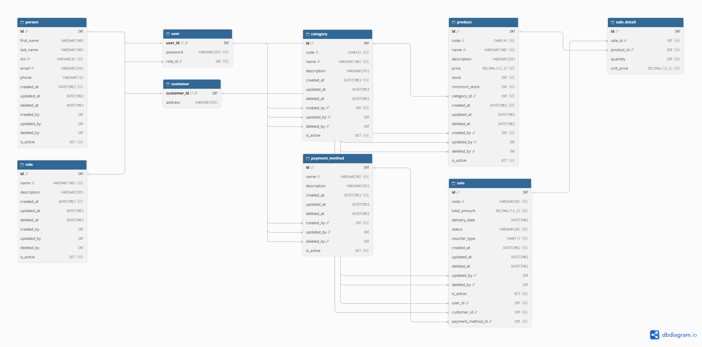
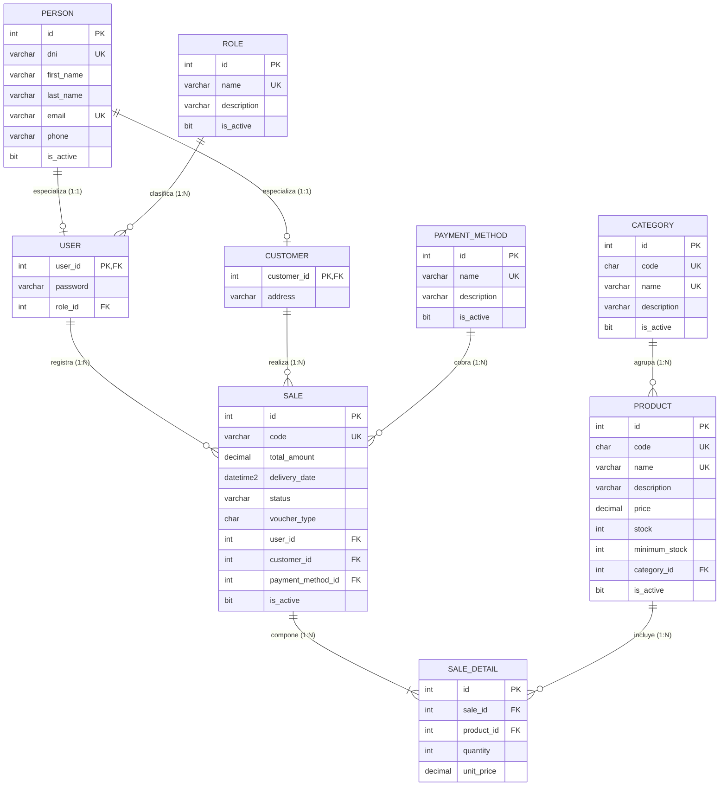

# Diagrama Entidad-Relación y Modelo de Datos (DER)

> **Proyecto:** Sistema de Gestión de Ventas — Matiensos  
> **Base de Datos:** `Matiensos_db`  
> **Motor:** Microsoft SQL Server 2019 / 2022 (Transact-SQL)  

---

## 1. Introducción y Enfoque del Modelo

El modelo de datos de **Matiensos** fue diseñado bajo la **Tercera Forma Normal (3FN)** para garantizar la eliminación de redundancias,
evitar anomalías de inserción, actualización y borrado, y blindar la consistencia de la información en el punto de venta.

### Aspectos Arquitectónicos Destacados:
- **Especialización (Table-per-Type):**  
  Se separa la entidad general `person` de sus especializaciones de rol y negocio (`user` y `customer`), compartiendo la clave primaria 1:1.
- **Trazabilidad y Auditoría Relacional:**  
  Las tablas principales incorporan marcas temporales (`created_at`, `updated_at`, `deleted_at`), indicadores de baja lógica (`is_active`)
  y claves foráneas de autoría (`created_by`, `updated_by`, `deleted_by`) vinculadas a la tabla `user`.
- **Inmutabilidad Contable e Histórica:**  
  La tabla `sale_detail` almacena el `unit_price` al momento exacto de la transacción, evitando que futuras fluctuaciones de precios en el
  catálogo alteren la recaudación histórica.
- **Validación en Capa de Persistencia:**  
  Uso intensivo de restricciones `CHECK` y `UNIQUE` para asegurar que precios, stocks, documentos y códigos cumplan reglas estrictas de
  negocio directamente en el motor de base de datos.

---

## 2. Diagrama Gráfico

A continuación se presenta el diagrama relacional completo generado a partir del script DDL (`01_DDL_Tablas.sql`):

> **Nota:** La imagen se encuentra alojada en el directorio `docs/img/der.png`.

---

## 3. Diagrama Entidad-Relación

Para visualización nativa e interactiva dentro del repositorio, el siguiente diagrama modela las 9 entidades y sus cardinalidades:

---

## 4. Esquema Lógico Relacional

Representación formal de las tablas según la notación estándar de bases de datos relacionales:

- **`person`** (  
  <u>id</u>, first_name, last_name, <u>dni</u>, <u>email</u>, phone,  
  created_at, updated_at, deleted_at, created_by, updated_by, deleted_by, is_active  
  )

- **`role`** (  
  <u>id</u>, <u>name</u>, description,  
  created_at, updated_at, deleted_at, created_by, updated_by, deleted_by, is_active  
  )

- **`user`** (  
  <u>user_id</u>*, password, role_id*  
  )  
  *user_id referencia a person(id)*  
  *role_id referencia a role(id)*

- **`customer`** (  
  <u>customer_id</u>*, address  
  )  
  *customer_id referencia a person(id)*

- **`category`** (  
  <u>id</u>, <u>code</u>, <u>name</u>, description,  
  created_at, updated_at, deleted_at, created_by*, updated_by*, deleted_by*, is_active  
  )  
  *created_by, updated_by, deleted_by referencian a user(user_id)*

- **`product`** (  
  <u>id</u>, <u>code</u>, <u>name</u>, description, price, stock, minimum_stock, category_id*,  
  created_at, updated_at, deleted_at, created_by*, updated_by*, deleted_by*, is_active  
  )  
  *category_id referencia a category(id)*  
  *created_by, updated_by, deleted_by referencian a user(user_id)*

- **`payment_method`** (  
  <u>id</u>, <u>name</u>, description,  
  created_at, updated_at, deleted_at, created_by*, updated_by*, deleted_by*, is_active  
  )  
  *created_by, updated_by, deleted_by referencian a user(user_id)*

- **`sale`** (  
  <u>id</u>, <u>code</u>, total_amount, delivery_date, status, voucher_type,  
  user_id*, customer_id*, payment_method_id*,  
  created_at, updated_at, deleted_at, updated_by*, deleted_by*, is_active  
  )  
  *user_id referencia a user(user_id)*  
  *customer_id referencia a customer(customer_id)*  
  *payment_method_id referencia a payment_method(id)*

- **`sale_detail`** (  
  <u>id</u>, sale_id*, product_id*, quantity, unit_price  
  )  
  *sale_id referencia a sale(id)*  
  *product_id referencia a product(id)*

---

## 5. Descripción de Relaciones y Cardinalidades

### 1. Persona y Especializaciones (`person`, `user`, `customer`)
- **Cardinalidad:** 1 a (0..1)  
- **Descripción:**  
  Una persona física puede operar como empleado del local (con usuario del sistema) o como cliente comercial. La tabla `person` 
  centraliza los datos básicos (DNI, nombre, contacto), mientras que `user` almacena la clave
  y el rol, y `customer` almacena el domicilio. La clave foránea comparte el mismo identificador que la clave primaria.

### 2. Rol y Usuario (`role` $\to$ `user`)
- **Cardinalidad:** 1 a N  
- **Descripción:**  
  Cada rol (*SuperAdmin*, *Administrador*, *Vendedor*) agrupa a múltiples usuarios, pero cada usuario posee un único rol activo.

### 3. Categoría y Producto (`category` $\to$ `product`)
- **Cardinalidad:** 1 a N  
- **Descripción:**  
  Una categoría puede contener múltiples productos del catálogo. Todo producto debe estar vinculado a una categoría obligatoria y activa.

### 4. Venta y Detalle (`sale` $\to$ `sale_detail`)
- **Cardinalidad:** 1 a N  
- **Descripción:**  
  Toda venta está compuesta por al menos un ítem en su detalle. La tabla `sale_detail` resuelve la relación muchos a muchos (N:M) entre ventas y
  productos, guardando la cantidad adquirida y congelando el precio unitario.

### 5. Venta y Relaciones Operativas
- **`user` $\to$ `sale` (1 a N):**  
  Cada venta consigna al empleado (vendedor) responsable que procesó la caja.
- **`customer` $\to$ `sale` (1 a N):**  
  Cada venta se vincula a un cliente registrado o al registro especial de **Consumidor Final** (DNI `99999999`).
- **`payment_method` $\to$ `sale` (1 a N):**  
  Toda transacción registra de forma obligatoria el medio de pago utilizado para cobrar (Efectivo, Débito, Transferencia, etc.).

---

## 6. Reglas de Integridad en Base de Datos

El modelo implementa restricciones nativas de SQL Server para garantizar la robustez de los datos:

- **Unicidad (`UNIQUE`):**  
  Garantiza que no existan duplicados en DNI, correos, nombres de roles, códigos de categoría, nombres de métodos de pago y códigos de venta.
- **Validación de Rango y Formato (`CHECK`):**  
  - Precios de venta mayores a cero (`price > 0`).
  - Stock actual y stock mínimo mayores o iguales a cero (`stock >= 0`).
  - DNI estrictamente numérico de 7 u 8 dígitos.
  - Correos electrónicos con formato sintáctico básico (`%_@__%.__%`).
  - Cantidades de venta estrictamente positivas (`quantity > 0`).
  - Estados de venta restringidos (`'Completada'`, `'Cancelada'`, `'Pendiente'`).
  - Tipos de comprobante válidos (`'A'`, `'B'`, `'C'`, `'X'`).
- **Baja Lógica (*Soft Delete*):**  
  Ninguna operación desde la interfaz ejecuta un `DELETE` físico sobre tablas con transacciones históricas. Se actualiza el campo `is_active = 0`
  y se estampa la fecha en `deleted_at`.
