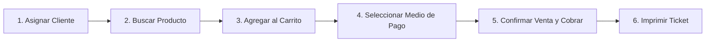

# 📘 Manual de Usuario — Matiensos

> **Sistema de Gestión de Ventas** 
> **Autoras:** Romero, Ingrid Luana | Torres, Jemina Cesia  

---

## 📋 Índice de Contenidos

1. [Introducción y Objetivos](#1-introducción-y-objetivos)
2. [Perfiles de Usuario y Permisos (RBAC)](#2-perfiles-de-usuario-y-permisos-rbac)
3. [Acceso al Sistema (Login)](#3-acceso-al-sistema-login)
4. [Entorno de Trabajo y Navegación Principal](#4-entorno-de-trabajo-y-navegación-principal)
5. [Módulo de Punto de Venta (Línea de Caja)](#5-módulo-de-punto-de-venta-línea-de-caja)
   - 5.1. Asignación de cliente
   - 5.2. Búsqueda y agregado de artículos al carrito
   - 5.3. Selección de medio de pago y cobro
   - 5.4. Emisión e impresión del comprobante (Ticket)
6. [Módulo de Clientes](#6-módulo-de-clientes)
   - 6.1. Búsqueda y filtrado
   - 6.2. Alta y modificación de clientes
   - 6.3. Estado y baja lógica
7. [Módulo de Catálogo e Inventario](#7-módulo-de-catálogo-e-inventario)
   - 7.1. Gestión de Productos y alerta de stock mínimo
   - 7.2. Gestión de Categorías
   - 7.3. Métodos de Pago
8. [Módulo de Historial de Ventas y Reportes](#8-módulo-de-historial-de-ventas-y-reportes)
   - 8.1. Consulta de ventas con filtros de fecha y pago
   - 8.2. Lectura de métricas (KPIs) y gráfico de ingresos
   - 8.3. Reimpresión de comprobantes y exportación de reportes
9. [Módulos Administrativos y de Seguridad](#9-módulos-administrativos-y-de-seguridad)
   - 9.1. Administración de Usuarios y Roles
   - 9.2. Consulta de Bitácora de Auditoría
   - 9.3. Resguardo y Copia de Seguridad (Backup)
10. [Preguntas Frecuentes y Solución de Problemas](#10-preguntas-frecuentes-y-solución-de-problemas)

---

## 1. Introducción y Objetivos

Bienvenido al **Manual de Usuario de Matiensos**. Este documento está diseñado para acompañar al personal operativo, de mostrador y de administración en el uso diario de la aplicación.

**Matiensos** es un sistema de escritorio integral que centraliza:
* La atención rápida en el mostrador mediante un Punto de Venta (POS) ágil.
* El control estricto de existencias con descuento automático de stock en tiempo real.
* La gestión de clientes y fidelización.
* La administración de catálogo, categorías y medios de cobro.
* La supervisión comercial mediante tarjetas de rendimiento (KPIs), gráficos estadísticos y emisión de reportes.

---

## 2. Perfiles de Usuario y Permisos (RBAC)

El acceso a las distintas funciones está regulado según el rol asignado al usuario en el sistema:

| Módulo / Funcionalidad | Vendedor | Administrador | Super Administrador |
| :--- | :---: | :---: | :---: |
| **Punto de Venta (Nueva Venta / Cobro)** | ✅ | ❌ | ❌ |
| **Emisión de Comprobantes (Tickets)** | ✅ | ❌ | ❌ |
| **Historial de Ventas** | ✅ (solo propias) | ✅ | ✅ |
| **Gestión de Clientes** | ✅ | ✅ | ✅ |
| **Catálogo de Productos y Stock** | ❌ (Solo consulta en caja) | ✅ | ✅ |
| **Catálogo de Categorías** | ❌ | ✅ | ✅ |
| **Métodos de Pago** | ❌ | ✅ | ✅ |
| **Reportes** | ✅ (solo propios) | ✅ (Auditoria, ventas) | ✅ (Auditoria, ventas) |
| **Bitácora de Auditoría** | ❌ | ✅ (Lectura) | ✅ (Lectura) |
| **Gestión de Usuarios y Roles** | ❌ | ❌ | ✅ |
| **Copias de Seguridad (Backup)** | ❌ | ❌ | ✅ |

---

## 3. Acceso al Sistema (Login)

Al iniciar la aplicación, se despliega la pantalla de autenticación:

### Pasos para iniciar sesión:
1. Ingrese su **Correo Electrónico** registrado.
2. Ingrese su **Contraseña**.
3. Haga clic en el botón **Ingresar** (o presione `Enter`).
4. Si las credenciales son válidas, el sistema cargará su sesión de trabajo y habilitará únicamente las opciones correspondientes a su perfil.

> [!NOTE]
> **Cuentas de demostración iniciales:**
> - **Super Administrador:** `super@matiensos.com` / Contraseña: `Super123!`
> - **Administrador:** `admin@matiensos.com` / Contraseña: `Admin123!`
> - **Vendedor:** `vendedor@matiensos.com` / Contraseña: `Ventas123!`

> [!WARNING]
> Si ingresa datos incorrectos, el sistema mostrará un mensaje de advertencia. Tras varios intentos fallidos consecutivos, por seguridad comuníquese con el Administrador.

---

## 4. Entorno de Trabajo y Navegación Principal

Una vez autenticado, se visualiza el **Menú Principal**:

* **Barra Superior:** Muestra el logo de Matiensos y el nombre del usuario en sesión activa, la fecha actual y los botones de control de ventana (minimizar, maximizar y cerrar).
* **Menú Lateral Izquierdo:** Panel de navegación con iconos y accesos directos a los módulos autorizados.
* **Área Central:** Espacio dinámico donde se abren las pantallas operativas sin salir de la aplicación principal.
* **Cerrar Sesión:** Botón ubicado al pie del menú lateral para salir de forma segura garantizando el cierre de su turno.

---

## 5. Módulo de Punto de Venta (Línea de Caja)

*(Disponible para Vendedores)*

El **Punto de Venta** (`FormVenta`) es el corazón operativo del mostrador. Permite registrar ventas de forma rápida en 4 pasos simples.

### 5.1. Asignación de cliente
* **Consumidor Final (Por defecto):** Si la persona no solicita registrar sus datos para factura nominada, se debe asignar al cliente genérico *"Consumidor Final"* (DNI 99999999).
* **Cliente Existente:** Ingrese el DNI del cliente en el campo de búsqueda y presione `Enter` o el botón **Buscar**. Los datos de la persona se asociarán automáticamente a la operación.
* **Nuevo Cliente Rápido:** Si el cliente no existe en la base de datos, presione el botón **"+ Nuevo Cliente"**. Se abrirá una ventana emergente ágil para registrar Nombre, Apellido, DNI y Teléfono en segundos sin abandonar la venta en curso.
* 
### 5.2. Búsqueda y agregado de artículos al carrito
1. En la sección **Productos**, utilice el buscador para escribir el **nombre** del artículo (ej. *"Imperial"*, *"Termo Stanley"*, *"Yerbera"*).
2. La grilla mostrará los productos coincidentes en tiempo real.
3. Ingrese la **Cantidad** deseada.
4. Haga clic en **Agregar Ítem**. El artículo se sumará a la grilla de detalle de la venta (carrito).
5. Si desea modificar o quitar un artículo cargado por error, seleccione la fila del carrito y presione **Eliminar**.

> [!IMPORTANT]
> El sistema **no permite** agregar una cantidad superior al stock existente. Si un producto no tiene existencias, la fila indicará stock en 0 y el botón de agregado se bloqueará preventivamente.

### 5.3. Selección de medio de pago y cobro
1. En el panel lateral de liquidación, seleccione el **Método de Pago** (Efectivo, Tarjeta de Débito, Tarjeta de Crédito, Transferencia, etc.).
2. El sistema calcula en tiempo real el **Subtotal** y el **Total Final**.
3. Si el pago es en *Efectivo*, ingrese el monto recibido en el campo **Monto Recibido**; el sistema calculará automáticamente el **Vuelto** a entregar.
4. Presione el botón **Confirmar Venta**.

### 5.4. Emisión e impresión del comprobante (Ticket)
* Una vez confirmada la venta, la transacción se guarda de forma atómica en la base de datos, se descuenta el stock de inmediato y se abre automáticamente el **Comprobante de Venta** (`FormTicket`).
* El ticket incluye: datos del comercio, número de comprobante único correlativo, fecha y hora, datos del vendedor, cliente, desglose de ítems y totales.
* Puede enviar el ticket a la impresora térmica de mostrador haciendo clic en **Imprimir**, o presionar **Cerrar** para continuar con la siguiente atención.

---

## 6. Módulo de Clientes

Permite mantener un padrón actualizado de los compradores frecuentes del local.

### 6.1. Búsqueda y filtrado
* Busque clientes en la grilla ingresando el número de **DNI** o parte del **Nombre / Apellido**.
* La grilla cuenta con paginación ágil de **15 registros por página**, lo que garantiza máxima velocidad de respuesta incluso con miles de registros cargados.

### 6.2. Alta y modificación de clientes
* **Alta (sólo Vendedor):** Haga clic en **"Nuevo Cliente"**, complete los campos requeridos (DNI, Nombre, Apellido, Teléfono, Correo, Dirección) y confirme con **Guardar**.
* **Edición:** En la fila correspondiente al cliente, presione el botón con el icono de lápiz (**Editar**). Modifique los datos necesarios y guarde los cambios.

### 6.3. Estado y baja lógica
* **Estado:** La columna *Estado* muestra visualmente en color **Verde (Activo)** o **Rojo (Inactivo)** la condición del cliente.
* **Baja Lógica:** Para desactivar un cliente, presione el icono de cesto de basura (**Eliminar**). El sistema no elimina físicamente el registro de la base de datos para preservar el historial de sus compras anteriores.

---

## 7. Módulo de Catálogo e Inventario

*(Disponible para Administradores y Super Administradores)*

### 7.1. Gestión de Productos y alerta de stock mínimo
Permite administrar las existencias del local:
1. **Alta de Producto:** Asigne un código único de 4 caracteres, nombre, categoría, precio, stock inicial y **Stock Mínimo de Alerta**.
2. **Alertas de Reposición:** Cuando el stock actual de un producto sea igual o menor a su stock mínimo configurado, el sistema informará mediante KPIs para que el encargado gestione la reposición con los proveedores.
3. **Modificación de Precios:** Los cambios de precio aplican únicamente para las futuras ventas; las ventas pasadas conservan su precio histórico inalterable.

### 7.2. Gestión de Categorías
* Permite organizar el catálogo en familias de artículos (ej. *Termos*, *Mates*, *Bombillas*, *Bolsos Materos*).
* Cada categoría posee un código nemotécnico de 4 caracteres y una descripción.

### 7.3. Métodos de Pago
* Permite dar de alta o pausar temporalmente canales de cobro (ej. habilitar nuevas billeteras virtuales como *Mercado Pago*, *MODO* o transferencias bancarias).
* Al inactivar un método de pago, este dejará de aparecer en las opciones de cobro del mostrador.

---

## 8. Módulo de Historial de Ventas y Reportes

*(Disponible para Vendedores, Administradores y Super Administradores)*

Permite auditar las operaciones comerciales y evaluar el desempeño del negocio.

### 8.1. Consulta de ventas con filtros de fecha y pago
* **Filtros por Fecha:** Seleccione la fecha de inicio (*Desde*) y de fin (*Hasta*). Por defecto se presenta el mes calendario en curso.
* **Filtro por Método de Pago:** Permite aislar ventas cobradas por un método específico o seleccionar *"Todos"*.
* Presione **Filtrar** para refrescar la lista y los indicadores.
* Presione **Limpiar** para reestablecer los filtros por defecto.

### 8.2. Lectura de métricas (KPIs) y gráfico de ingresos
La pantalla presenta tres tarjetas de control instantáneo:
* **Ventas:** Cantidad total de comprobantes emitidos en el período.
* **Recaudación:** Suma total facturada en pesos argentinos.
* **Rubro Top:** La categoría de productos con mayor volumen de venta.

A la izquierda, el panel **GRÁFICO INGRESOS** exhibe un gráfico de torta dinámico que ilustra la participación porcentual de cada método de pago sobre el total facturado, con los montos claramente identificados fuera de cada porción.

### 8.3. Reimpresión de comprobantes y exportación de reportes
* **Ver comprobante:** En cualquier fila de la grilla, haga clic en el botón **Ver** para reabrir el ticket original de la venta e imprimirlo nuevamente.
* **Imprimir Reporte General:** El botón **Imprimir** de la barra superior genera un reporte analítico en formato imprimible con el resumen del período, el gráfico de torta de recaudación y el desglose de todas las transacciones.

---

## 9. Módulos Administrativos y de Seguridad

*(Exclusivo para Super Administrador y perfiles autorizados)*

### 9.1. Administración de Usuarios y Roles
1. Permite crear las cuentas del personal asignándoles su rol correspondiente (*Administrador*, *Vendedor*).
2. Se pueden restablecer contraseñas y dar de baja a empleados que ya no formen parte del local.
3. **Protección SuperAdmin:** Por seguridad, el sistema no permite que la cuenta del Super Administrador principal sea dada de baja ni degradada de rol.

### 9.2. Consulta de Bitácora de Auditoría
El sistema registra automáticamente en archivos de bitácora mensuales toda acción crítica realizada:
* Inicios y cierres de sesión.
* Creación, edición o anulación de usuarios.
* Modificaciones de precios y ajustes manuales de stock.

La pantalla de **Auditoría** permite buscar por fecha, tipo de evento o usuario interviniente para garantizar total transparencia ante cualquier discrepancia.

### 9.3. Resguardo y Copia de Seguridad (Backup)
* Permite generar una copia de seguridad íntegra de la base de datos SQL Server (`.bak`) en una ruta segura con un solo clic.
* Se recomienda generar un backup al cierre de cada jornada comercial semanal.

---

## 10. Preguntas Frecuentes y Solución de Problemas

#### ❓ ¿Qué hago si un producto no aparece en el buscador de la venta?
Consulte a un Administrador por el estado del producto, el mismo debe figurar como **Activo**. Si el producto fue dado de baja lógica, no se listará en el mostrador.

#### ❓ El sistema no me permite confirmar una venta por falta de stock.
El sistema cuenta con validación estricta de existencias para evitar ventas de mercadería inexistente. Si físicamente tiene el producto en el mostrador pero el sistema indica stock insuficiente, el Administrador debe registrar el ingreso de mercadería en el módulo de *Productos*.

#### ❓ ¿Cómo cobro una venta que el cliente paga una parte con débito y otra en efectivo?
Actualmente cada comprobante se emite asociado a un método de pago principal. Para cobros mixtos, puede convenir con el cliente registrar dos comprobantes separados por los artículos correspondientes.

#### ❓ ¿Cómo cambio mi contraseña de acceso?
Solicite al Administrador del sistema el restablecimiento de su clave.

---

**Matiensos — Calidad y Tradición en Cada Mate**  
*Manual de Usuario — Versión 1.0 (2026)*

